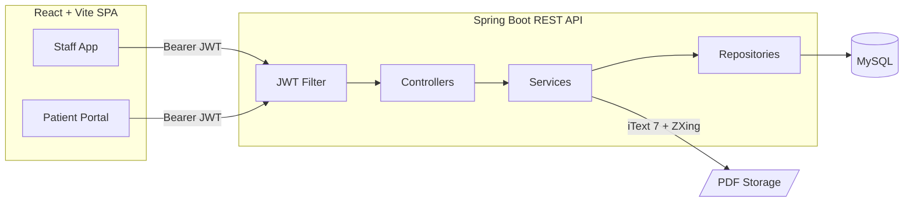
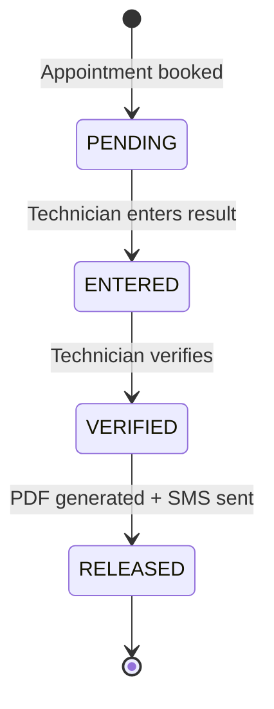

<div align="center">

# 🧪 MedLab Pro
### Medical Laboratory Management System

A full-stack platform that digitises the entire laboratory workflow, from patient registration and billing to result verification, PDF report generation and a secure patient portal.


[Features](#-features) · [Architecture](#-architecture) · [Getting Started](#-getting-started) · [API Reference](#-api-reference) · [Roadmap](#-roadmap)

</div>

---

## 📖 Overview

**MedLab Pro** supports four types of users across the lab's daily operations:

| User | Purpose |
|---|---|
| 🛡️ **Admin** | Oversees the system, manages staff and the test catalogue, releases reports |
| 🧾 **Receptionist** | Registers patients, books appointments, records payments |
| 🔬 **Technician** | Enters and verifies test results, releases reports |
| 🧑‍⚕️ **Patient** | Views and downloads their own reports through a secure portal |

---

## ✨ Features

### Staff application
- **Role-based access control** with JWT authentication and protected routes
- **Forced password change** on first login for new staff accounts
- **Patient management**: registration, NIC lookup, search and pagination
- **Appointment booking**: multi-test selection, live total, automatic invoice number
- **Payment tracking**: mark appointments as paid, view daily appointments with filters
- **Technician queue**: enter results, verify with an automatic `HIGH` / `LOW` / `NORMAL` flag, release reports
- **Role-specific dashboards** with summary cards and quick actions

### Patient portal
- **Passwordless login** using NIC + registered mobile number + 6-digit OTP
- OTP is **single use** and expires in **5 minutes**
- View released reports and open the PDF
- **QR code verification**: each printed report carries a QR code that opens the report online

### Reports and documents
- PDF generated with **iText 7**: lab letterhead, patient details, results table, abnormal values highlighted in red, embedded QR code
- PDFs stored on disk (`reports/YYYY/MM/`); only the relative path is stored in the database
- SMS notification on report release (gateway integration point provided)

---

## 🏗 Architecture



### Report lifecycle



### Project structure

<details>
<summary><b>Backend</b> (<code>lab-backend/</code>)</summary>

```
lab-backend/
├── pom.xml
└── src/main/
    ├── java/com/laboratory/managementSystem/
    │   ├── config/          SecurityConfig, JwtAuthFilter, WebConfig (CORS)
    │   ├── controller/      Auth, Patient, Appointment, LabReport, Portal
    │   ├── dto/
    │   │   ├── request/     AuthRequestDTO, OtpRequestDTO, PatientRegisterDTO, ReportResultDTO
    │   │   └── response/    AuthResponseDTO, ReportViewDTO
    │   ├── entity/          SystemUser, Patient, LabTest, Appointment, LabReport, OtpVerification
    │   ├── exception/       Custom exceptions + GlobalExceptionHandler
    │   ├── repository/      Spring Data JPA repositories
    │   ├── service/         Service interfaces
    │   │   └── impl/        Service implementations
    │   └── util/            OtpGenerator, QrCodeGenerator, DateTimeUtil
    └── resources/
        └── application.properties
```
</details>

<details>
<summary><b>Frontend</b> (<code>lab-frontend/</code>)</summary>

```
lab-frontend/
├── package.json
├── vite.config.js
├── .env.example
└── src/
    ├── components/
    │   ├── common/          StatusBadge, ResultFlagBadge, StatsCard, Pagination, SearchBar, ...
    │   └── layout/          Sidebar, TopNavbar
    ├── context/             AuthContext
    ├── hooks/               useApi
    ├── layouts/             MainLayout, PortalLayout
    ├── pages/
    │   ├── auth/            Login, ChangePassword
    │   ├── admin/           Dashboard, Users, Lab Tests
    │   ├── receptionist/    Dashboard, Patients, Appointments, Reports
    │   ├── technician/      Dashboard, Queue, Enter / Verify / Release
    │   ├── portal/          Login, OTP, My Reports, QR Viewer
    │   └── errors/          404, Unauthorized
    ├── routes/              ProtectedRoute
    ├── services/            Axios instance + API modules
    ├── styles/
    ├── utils/
    ├── App.jsx
    └── main.jsx
```
</details>

---

## 🚀 Getting Started

### Prerequisites

| Tool | Version |
|---|---|
| JDK | 17+ |
| Maven | 3.8+ |
| MySQL | 8+ |
| Node.js | 18+ |

### 1. Clone the repository

```bash
git clone https://github.com/<your-username>/<your-repo>.git
cd <your-repo>
```

### 2. Create the database

```sql
CREATE DATABASE lab_management;
```

Tables are created automatically on first start (`spring.jpa.hibernate.ddl-auto=update`).

### 3. Configure and run the backend

Edit `lab-backend/src/main/resources/application.properties`:

```properties
spring.datasource.url=jdbc:mysql://localhost:3306/lab_management?useSSL=false&serverTimezone=Asia/Colombo&allowPublicKeyRetrieval=true
spring.datasource.username=root
spring.datasource.password=your_mysql_password

# Generate a secret with: openssl rand -hex 32
app.jwt.secret=change-me-to-a-long-random-secret
app.jwt.expiration-ms=86400000

# Writable folder for generated PDF reports
storage.base-path=/var/labstorage

app.cors.allowed-origins=http://localhost:3000
app.portal.base-url=http://localhost:3000
```

```bash
cd lab-backend
mvn spring-boot:run
```

The API starts on **http://localhost:8080**.

### 4. Create the first admin account

The backend does not seed data. Insert the first `ADMIN` row into `system_user` manually with a **BCrypt-hashed** password (strength 12), `is_active = 1` and `is_password_changed = 1`.

> Staff accounts created later receive the default password `Lab@1234` and must change it at first login.

### 5. Run the frontend

```bash
cd lab-frontend
cp .env.example .env
npm install
npm run dev
```

The app starts on **http://localhost:3000**.

```bash
npm run build      # production build
npm run preview    # preview the production build
```

### Environment variables (frontend)

| Variable | Description | Default |
|---|---|---|
| `VITE_API_BASE_URL` | Backend base URL | `http://localhost:8080` |
| `VITE_PORTAL_BASE_URL` | Portal URL used in QR links | `http://localhost:3000` |

---

## 🔐 Authentication

| Flow | Steps |
|---|---|
| **Staff** | `POST /api/auth/login` returns a JWT (24 h) with `role` and `userId` claims. If `isPasswordChanged` is `false`, the user is redirected to change the password. |
| **Patient** | `POST /api/auth/request-otp` (NIC + mobile) sends a 6-digit OTP, then `POST /api/auth/verify-otp` returns a JWT with `role = PATIENT` and `patientId`. |

Send the token on every protected request:

```
Authorization: Bearer <token>
```

Technician endpoints also expect `X-User-Id`, and the portal endpoint `/api/portal/reports/me` expects `X-Patient-Id`. The frontend adds both automatically.

---

## 📡 API Reference

Base URL: `http://localhost:8080`

| Module | Endpoint | Method | Access |
|---|---|---|---|
| **Auth** | `/api/auth/login` | POST | Public |
| | `/api/auth/request-otp` | POST | Public |
| | `/api/auth/verify-otp` | POST | Public |
| **Patients** | `/api/patients/register` | POST | Admin, Receptionist |
| | `/api/patients` | GET | Admin, Receptionist |
| | `/api/patients/{id}` | GET | Admin, Receptionist, Technician |
| | `/api/patients/nic/{nic}` | GET | Admin, Receptionist |
| **Appointments** | `/api/appointments` | POST | Admin, Receptionist |
| | `/api/appointments/{id}` | GET | Admin, Receptionist |
| | `/api/appointments/{id}/pay` | PATCH | Admin, Receptionist |
| | `/api/appointments/patient/{patientId}` | GET | Admin, Receptionist |
| | `/api/appointments/date?date=YYYY-MM-DD` | GET | Admin, Receptionist |
| **Reports** | `/api/reports/pending` | GET | Technician |
| | `/api/reports/{id}/result` | PUT | Technician |
| | `/api/reports/{id}/verify` | PATCH | Technician |
| | `/api/reports/{id}/release` | PATCH | Technician, Admin |
| | `/api/reports/patient/{patientId}` | GET | Admin, Receptionist |
| **Portal** | `/api/portal/r/{qrToken}` | GET | Public |
| | `/api/portal/reports/me` | GET | Patient |
| | `/api/portal/reports/{pdfPath}/pdf` | GET | Patient |

<details>
<summary><b>Error response format</b></summary>

```json
{
  "timestamp": "2026-06-07T14:35:00",
  "status": 404,
  "error": "Not Found",
  "message": "Patient not found with NIC: 199512345678"
}
```

Validation failures return `status: 400` with a `details` object listing each invalid field.
</details>

---

## 🛠 Tech Stack

| Layer | Technologies |
|---|---|
| **Backend** | Java 17, Spring Boot 3.2.5, Spring Security, Spring Data JPA, Lombok |
| **Security** | JWT (JJWT 0.11.5), BCrypt (strength 12), role-based `@PreAuthorize` |
| **Database** | MySQL 8, Hibernate |
| **Documents** | iText 7.2.5 (PDF), ZXing 3.5.2 (QR codes) |
| **Frontend** | React 18, Vite 5, React Router 6, Axios, Bootstrap 5, Bootstrap Icons |

---

## 🧭 Roadmap

The following items are not complete yet:

- [ ] `UserController` and `LabTestController`. The service layer exists and the frontend pages call `/api/users` and `/api/tests`, but the REST endpoints still have to be added
- [ ] Real SMS gateway. OTP and release notifications currently print to the server console (`AuthServiceImpl.sendSms()`)
- [ ] Printable invoice. Invoice number and total are stored and shown, but there is no invoice PDF or print endpoint
- [ ] Persistent invoice sequence. The daily counter is in memory and resets on restart
- [ ] Refresh tokens. JWTs are valid for 24 hours with no renewal
- [ ] Hashed OTP storage

---

## 🤝 Contributing

1. Fork the repository
2. Create a feature branch: `git checkout -b feature/your-feature`
3. Commit your changes: `git commit -m "Add your feature"`
4. Push the branch: `git push origin feature/your-feature`
5. Open a pull request

---


<div align="center">

Built with Spring Boot and React

</div>
